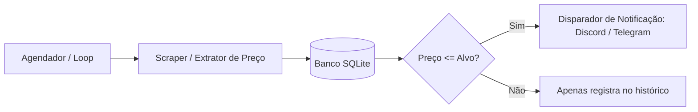

# Guia e Histórico da Conversa — Projeto: Rastreador de Preços em Python

Este documento reúne toda a explicação conceitual, arquitetura e instruções do projeto desenvolvidas durante a nossa conversa.

---

## 1. Visão Geral do Projeto

O objetivo do sistema é **monitorar produtos na internet automaticamente** para avisar quando o preço atingir ou ficar abaixo do valor que você deseja pagar, sem precisar abrir o site manualmente todos os dias.

### Fluxo de Funcionamento



---

## 2. Explicação de Cada Módulo do Código

### 1. Extração do Preço (`scraper.py`)
* **Acessa a página:** Envia uma requisição HTTP para a URL do produto usando cabeçalhos (`User-Agent`) para simular um navegador real e evitar bloqueios simples.
* **Lê o HTML:** Usa o `BeautifulSoup` para procurar onde o preço está na página (compatível com **Mercado Livre**, **Books to Scrape** e meta tags padrão de e-commerces).
* **Limpa e converte o dado (`clean_price`):** O preço vem como texto (ex: `"R$ 1.899,90"`). A função remove símbolos de moeda e converte para número decimal do Python (`float`: `1899.90`), permitindo comparações matemáticas.

### 2. Armazenamento e Memória (`database.py`)
Usa o **SQLite** (banco de dados nativo do Python, salvo no arquivo local `prices.db`):
* **Tabela `products`:** Guarda o nome do produto, link (`url`), preço desejado (`target_price`) e o último preço notificado (`last_notified_price`).
* **Tabela `price_history`:** Guarda cada leitura de preço junto com a data e hora (`checked_at`), permitindo acompanhar o histórico de variação ao longo do tempo.

### 3. Módulo de Notificação (`notifier.py`)
* Formata uma mensagem clara com o nome do produto, preço atual, preço-alvo e link direto de compra.
* Exibe o alerta no terminal e, caso configurado no arquivo `.env`, envia a mensagem diretamente para o seu **Discord** (via Webhook) ou **Telegram** (via Bot).

### 4. Lógica Principal (`main.py`)
É o cérebro que conecta tudo:
1. Inicializa o banco de dados (`init_db()`).
2. Busca todos os produtos cadastrados (`get_all_products()`).
3. Para cada produto, consulta o preço atual (`fetch_product_info()`), grava no histórico (`record_price()`) e verifica:
   $$\text{Preço Atual} \le \text{Preço Alvo}$$
4. Se atingiu a meta (e ainda não notificou por esse valor), dispara o alerta e atualiza o registro.

---

## 3. Estrutura de Arquivos

```text
rastreador-de-sites/
├── CONVERSA_E_GUIA.md  # Este resumo completo da nossa conversa e explicação do sistema
├── database.py         # Criação e operações no banco de dados SQLite (prices.db)
├── scraper.py          # Extração e limpeza do preço a partir da URL do produto
├── notifier.py         # Envio de alertas no terminal, Discord e Telegram
├── main.py             # Orquestrador principal que executa a verificação
├── requirements.txt    # Lista de bibliotecas Python necessárias
└── .env.example        # Exemplo de configuração para variáveis do Discord/Telegram
```

---

## 4. Como Executar o Projeto

No terminal, dentro da pasta `rastreador-de-sites`, execute:

```bash
# 1. Crie e ative um ambiente virtual
python3 -m venv .venv
source .venv/bin/activate

# 2. Instale as dependências
pip install -r requirements.txt

# 3. Execute o rastreador
python3 main.py
```

### Como configurar alertas no Discord ou Telegram (Opcional)
1. Faça uma cópia do arquivo `.env.example` com o nome `.env`:
   ```bash
   cp .env.example .env
   ```
2. Preencha `DISCORD_WEBHOOK_URL` (criado nas configurações do canal do seu servidor Discord) ou `TELEGRAM_BOT_TOKEN` + `TELEGRAM_CHAT_ID`.
