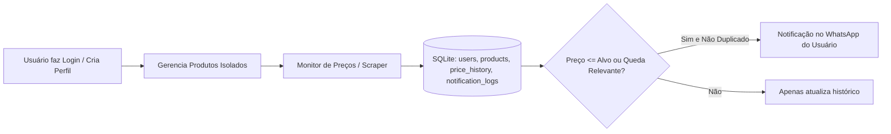

# Guia e Histórico da Conversa — Plataforma Multiusuário de Monitoramento de Preços com WhatsApp

Este documento reúne a arquitetura e as instruções atualizadas do projeto, agora com **perfis individuais de usuários**, **isolamento completo de dados**, **exclusão segura de produtos** e **notificações via WhatsApp**.

---

## 1. Visão Geral da Plataforma

O sistema permite que múltiplas pessoas criem suas próprias contas (perfis individuais), cadastrem os produtos que desejam monitorar de forma 100% isolada e recebam alertas de queda de preço diretamente em seus respectivos números de **WhatsApp**.

### Fluxo de Funcionamento



---

## 2. Principais Funcionalidades Implementadas

### 1. Sistema de Usuários e Perfis Isolados (`database.py` e `app.py`)
* **Cadastro e Login com Senha Criptografada:** Senhas protegidas com hash `PBKDF2-HMAC-SHA256` e `salt` aleatório.
* **Isolamento Completo:** Cada produto pertence exclusivamente ao `user_id` que o cadastrou (`UNIQUE(user_id, url)`). Nenhum usuário consegue visualizar, editar ou excluir produtos ou históricos de outra pessoa.

### 2. Notificações Personalizadas via WhatsApp (`notifier.py`)
* **Número Individual por Perfil:** Cada usuário cadastra e atualiza seu próprio número de WhatsApp na aba **📱 Meu WhatsApp & Perfil**.
* **Prevenção de Duplicidade:** O sistema registra `last_notified_price` e `last_price`, evitando reenviar alertas repetidos para o mesmo valor.
* **Modos de Disparo WhatsApp:**
  * **Automático e Gratuito (CallMeBot API):** Basta o usuário informar sua chave gratuita do CallMeBot no perfil para receber mensagens em segundo plano.
  * **Gateways / Twilio / Evolution API:** Suporte via variáveis no arquivo `.env`.
  * **Link Direto (`wa.me`):** Botão de 1 clique no painel para abrir/enviar o alerta formatado diretamente no WhatsApp (iOS, Android ou Web).

### 3. Gerenciamento e Exclusão Segura de Produtos (`app.py` e `database.py`)
* **Adição e Edição de Preço Alvo:** Cada usuário adiciona produtos à sua lista e pode ajustar o preço desejado a qualquer momento.
* **Remoção com Confirmação:** Ao clicar em **"🗑️ Parar de Monitorar"**, o sistema solicita confirmação explícita antes de apagar, interrompendo imediatamente o monitoramento e removendo o histórico daquele produto.

---

## 3. Como Atualizar no GitHub e Streamlit Cloud

Para enviar esta nova versão para o seu link público do Streamlit Cloud:

```bash
cd /Users/paulo/rastreador-de-sites
git add .
git commit -m "Adiciona sistema multiusuário, alertas via WhatsApp e exclusão de produtos"
git push
```
*(O Streamlit Cloud detecta o `git push` e atualiza o site automaticamente em poucos segundos!)*
